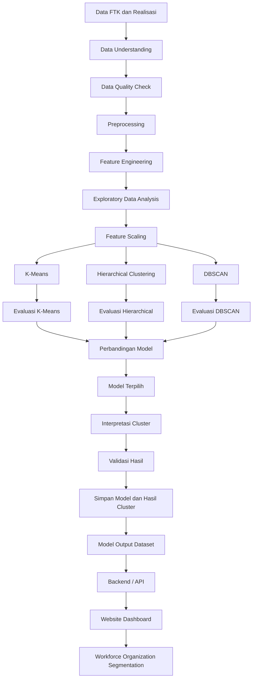
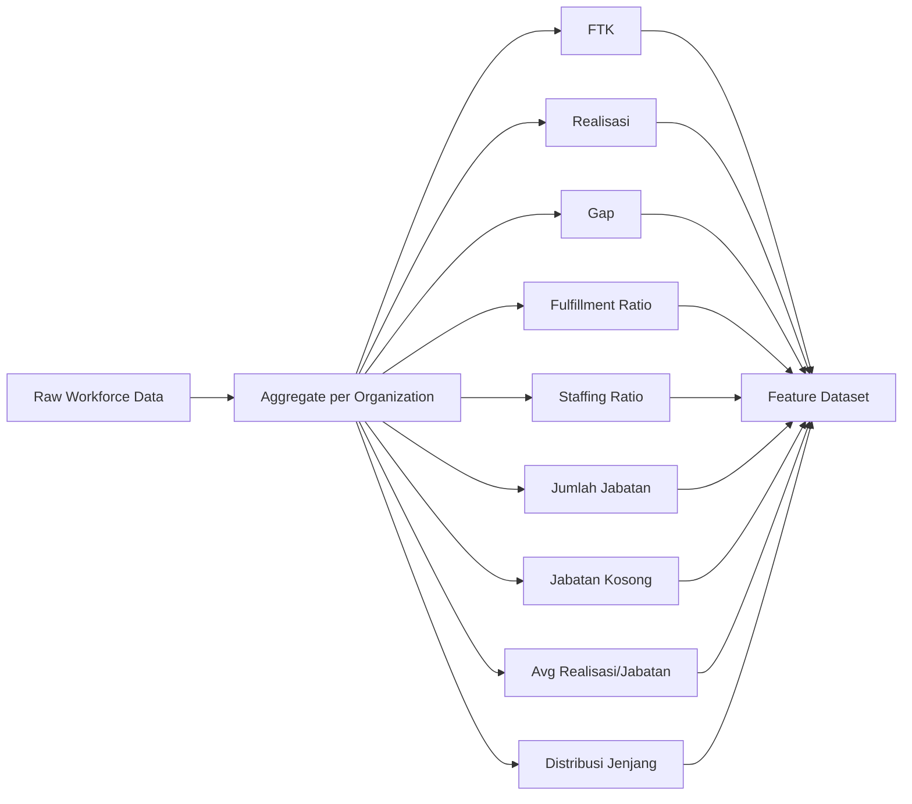
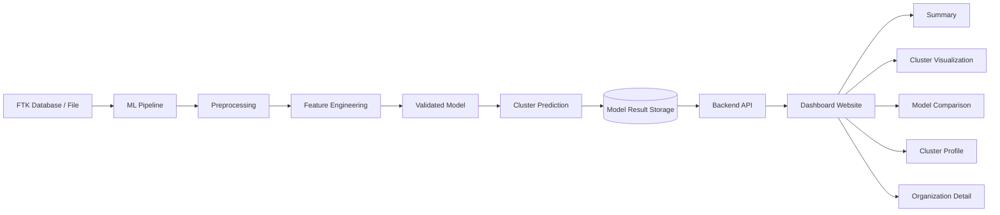
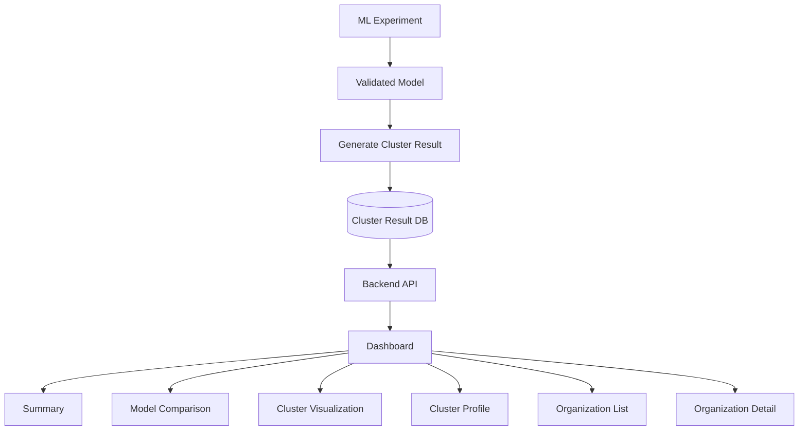
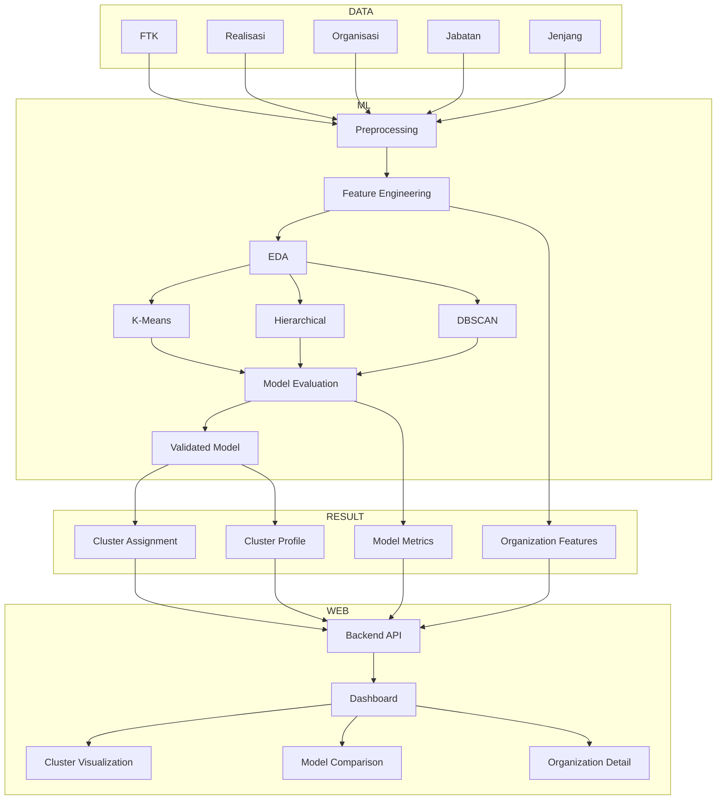

# Product Requirements Document

## Workforce Organization Segmentation

**Versi:** 1.0
**Status:** Draft
**Domain:** Human Capital / Workforce Planning
**Pendekatan:** Unsupervised Machine Learning
**Metode Utama:** K-Means, Hierarchical Clustering, DBSCAN
**Output Akhir:** Model clustering tervalidasi + Website Dashboard Workforce Organization Segmentation

---

# 1. Latar Belakang

Direktorat Legal dan Manajemen Human Capital memiliki data **Formasi Tenaga Kerja (FTK)** dan **Realisasi Tenaga Kerja** dengan struktur organisasi bertingkat hingga level jabatan.

Saat ini kondisi tenaga kerja pada suatu organisasi dapat dilihat melalui angka FTK, realisasi, serta gap antara kebutuhan dan jumlah pegawai aktual. Namun analisis berbasis angka tersebut belum secara otomatis mengidentifikasi pola organisasi yang memiliki karakteristik tenaga kerja serupa.

Diperlukan pendekatan Machine Learning yang dapat melakukan **segmentasi organisasi secara otomatis berdasarkan karakteristik FTK dan Realisasi** tanpa membutuhkan label kategori yang telah ditentukan sebelumnya.

Pendekatan yang digunakan adalah **Unsupervised Learning melalui clustering**.

Tiga metode clustering akan dibandingkan:

1. K-Means
2. Hierarchical Clustering
3. DBSCAN

Model akan mengeksplorasi pola yang terbentuk dari data dan kemudian cluster yang dihasilkan akan dianalisis untuk memperoleh karakteristik seperti:

* Organisasi relatif stabil.
* Organisasi mengalami understaffing.
* Organisasi memiliki potensi overstaffing.
* Organisasi dengan workforce volatility tinggi.
* Pola lain yang ditemukan secara natural dari data.

> Nama dan interpretasi cluster tidak ditentukan sebelum model dijalankan. Label seperti “Relatif Stabil”, “Understaffing”, “Overstaffing”, dan “Workforce Volatility Tinggi” diberikan setelah karakteristik masing-masing cluster dianalisis.

---

# 2. Tujuan

Tujuan utama sistem adalah mengembangkan model Machine Learning yang mampu:

1. Mengelompokkan organisasi berdasarkan kondisi FTK dan Realisasi.
2. Menemukan pola workforce yang tidak mudah terlihat hanya melalui analisis tabel.
3. Membandingkan performa K-Means, Hierarchical Clustering, dan DBSCAN.
4. Menentukan metode clustering yang paling sesuai berdasarkan hasil evaluasi.
5. Menghasilkan profil setiap cluster yang dapat dipahami oleh pengguna bisnis.
6. Menyediakan hasil analisis dalam bentuk website interaktif.
7. Menyediakan dashboard yang menggunakan hasil model Machine Learning yang telah tervalidasi.
8. Mendukung analisis kondisi workforce berdasarkan periode dan hierarki organisasi apabila data tersedia.

---

# 3. Ruang Lingkup

## 3.1 In Scope

Prototype mencakup:

* Data FTK organisasi.
* Data realisasi pegawai.
* Hierarki organisasi.
* Data jabatan.
* Data jenjang jabatan.
* Feature engineering.
* Exploratory Data Analysis.
* Training/eksperimen K-Means.
* Training/eksperimen Hierarchical Clustering.
* Training/eksperimen DBSCAN.
* Evaluasi ketiga metode.
* Pemilihan model terbaik.
* Interpretasi cluster.
* Penyimpanan hasil clustering.
* Website Dashboard Workforce Organization Segmentation.
* Visualisasi hasil clustering.
* Perbandingan model.

## 3.2 Out of Scope untuk Prototype Awal

Belum termasuk:

* Prediksi kebutuhan workforce masa depan.
* Rekomendasi mutasi pegawai.
* Optimasi penempatan pegawai.
* Reinforcement Learning.
* Workforce forecasting.
* Automatic recruitment recommendation.
* Keputusan HR secara otomatis.
* Generative AI sebagai pengambil keputusan.

Fitur tersebut dapat menjadi tahap pengembangan selanjutnya.

---

# 4. Pertanyaan Bisnis

Model diharapkan membantu menjawab pertanyaan seperti:

* Organisasi mana yang memiliki karakteristik workforce serupa?
* Organisasi mana yang memiliki tingkat fulfillment relatif stabil?
* Organisasi mana yang menunjukkan kondisi understaffing?
* Organisasi mana yang memiliki realisasi lebih besar dibandingkan FTK?
* Organisasi mana yang memiliki banyak posisi kosong?
* Apakah terdapat kelompok organisasi dengan pola workforce tertentu?
* Apakah terdapat organisasi yang tidak sesuai dengan kelompok mayoritas?
* Bagaimana karakteristik masing-masing cluster?
* Metode clustering apa yang paling sesuai terhadap karakteristik dataset?

---

# 5. Konsep Utama

Secara sederhana:

```text
FTK
 │
 ├── Kebutuhan/Formasi
 │
 └──────────────┐
                │
                ▼
             GAP FTK
                ▲
                │
 ┌──────────────┘
 │
Realisasi
 │
 └── Kondisi tenaga kerja aktual
```

Model clustering tidak hanya menggunakan FTK dan Realisasi secara langsung, tetapi menggunakan karakteristik workforce yang lebih luas.

---

# 6. Feature Model

Feature utama yang digunakan:

| Feature                         | Deskripsi                                          |
| ------------------------------- | -------------------------------------------------- |
| FTK                             | Jumlah tenaga kerja yang direncanakan/dibutuhkan   |
| Realisasi                       | Jumlah tenaga kerja aktual                         |
| Gap                             | Selisih FTK dengan Realisasi                       |
| Fulfillment Ratio               | Tingkat pemenuhan FTK                              |
| Over/Under Staffing Ratio       | Tingkat kelebihan atau kekurangan tenaga kerja     |
| Jumlah Jabatan                  | Jumlah jabatan pada organisasi                     |
| Jumlah Jabatan Kosong           | Jumlah jabatan tanpa realisasi pegawai             |
| Rata-rata Realisasi per Jabatan | Rata-rata pegawai pada setiap jabatan              |
| Distribusi Jenjang Jabatan      | Komposisi tenaga kerja berdasarkan jenjang jabatan |

---

# 7. Definisi Feature

## 7.1 Gap

Formula:

```text
Gap = FTK - Realisasi
```

Interpretasi:

```text
Gap > 0
→ Kekurangan pegawai

Gap = 0
→ FTK terpenuhi

Gap < 0
→ Realisasi melebihi FTK
```

---

# 8. Fulfillment Ratio

Formula:

```text
Fulfillment Ratio = Realisasi / FTK
```

atau:

```text
Fulfillment Ratio (%) =
(Realisasi / FTK) × 100
```

Contoh:

```text
FTK       = 100
Realisasi = 90

Fulfillment Ratio = 90%
```

Edge case FTK = 0 harus memiliki treatment khusus dan tidak langsung melakukan pembagian.

---

# 9. Over/Under Staffing Ratio

Salah satu formula awal:

```text
Staffing Ratio =
(Realisasi - FTK) / FTK
```

Interpretasi:

```text
< 0 → understaffing
= 0 → balance
> 0 → overstaffing
```

Contoh:

```text
FTK       : 10
Realisasi : 7

Staffing Ratio:
(7 - 10) / 10
= -0.30

→ understaffing 30%
```

---

# 10. Jumlah Jabatan Kosong

Definisi:

Jumlah posisi/jabatan yang memiliki:

```text
FTK > 0
```

tetapi:

```text
Realisasi = 0
```

Contoh:

```text
Jabatan A → FTK 3 → Realisasi 3
Jabatan B → FTK 2 → Realisasi 0
Jabatan C → FTK 1 → Realisasi 0

Jumlah Jabatan Kosong = 2
```

---

# 11. Rata-rata Realisasi per Jabatan

Formula:

```text
Total Realisasi
---------------------
Jumlah Jabatan
```

Feature ini membantu membedakan organisasi besar dan organisasi kecil berdasarkan struktur jabatan.

---

# 12. Distribusi Jenjang Jabatan

Distribusi jenjang tidak direpresentasikan menjadi satu nilai.

Contoh apabila terdapat jenjang:

```text
MAK
MA
MM
MD
Spesialis
Generalis
```

maka feature dapat dibentuk:

```text
pct_MAK
pct_MA
pct_MM
pct_MD
pct_Spesialis
pct_Generalis
```

Contoh:

```text
Organisasi A

MAK       = 3%
MA        = 7%
MM        = 15%
MD        = 20%
Spesialis = 25%
Generalis = 30%
```

Dengan demikian model dapat memahami struktur komposisi workforce.

---

# 13. Data yang Harus Disiapkan

## 13.1 Dataset Minimum

Minimal data memiliki:

| Data              |             Wajib |
| ----------------- | ----------------: |
| ID Organisasi     |                Ya |
| Nama Organisasi   |                Ya |
| Parent Organisasi |        Disarankan |
| Level Organisasi  |                Ya |
| ID Jabatan        |                Ya |
| Nama Jabatan      |                Ya |
| Jenjang Jabatan   |                Ya |
| FTK Jabatan       |                Ya |
| Realisasi Jabatan |                Ya |
| Periode Data      | Sangat disarankan |

Contoh:

```text
periode
kode_organisasi
nama_organisasi
parent_organisasi
level_organisasi
kode_jabatan
nama_jabatan
jenjang_jabatan
ftk
realisasi
```

---

# 14. Contoh Dataset Raw

```text
periode    organisasi    jabatan            jenjang    ftk    realisasi

2026-08    DIVISI A      MANAGER A          MM          1        1
2026-08    DIVISI A      OFFICER A          MD          5        4
2026-08    DIVISI A      ANALYST A          GEN        10        7

2026-08    DIVISI B      MANAGER B          MM          1        1
2026-08    DIVISI B      OFFICER B          MD          4        5
2026-08    DIVISI B      ANALYST B          GEN         8        9
```

Data tersebut kemudian diagregasikan pada level organisasi.

---

# 15. Data Ideal

Apabila tersedia, data berikut dapat meningkatkan kualitas analisis:

```text
periode
kode organisasi
hierarki organisasi
kode jabatan
nama jabatan
jenjang jabatan
FTK
realisasi
status jabatan
status pegawai
```

Data historis sangat direkomendasikan:

```text
Jan 2024
Feb 2024
...
Aug 2026
```

Data historis memungkinkan penambahan feature workforce volatility.

---

# 16. Workforce Volatility

Jika tersedia histori, feature tambahan yang sangat direkomendasikan:

```text
Gap Variance
Realisasi Variance
Fulfillment Ratio Variance
Perubahan Realisasi MoM
Perubahan Gap MoM
```

Contoh:

```text
Organisasi A

Jan → 97%
Feb → 98%
Mar → 96%
Apr → 97%

→ stabil
```

dibanding:

```text
Organisasi B

Jan → 90%
Feb → 55%
Mar → 110%
Apr → 65%

→ high volatility
```

Tanpa data historis, istilah **workforce volatility tinggi** sebaiknya tidak ditentukan hanya berdasarkan satu snapshot.

---

# 17. Unit Analisis

Unit analisis utama adalah:

> **Organisasi pada periode tertentu**

Dataset model setelah agregasi:

```text
organization_id
period
ftk
realization
gap
fulfillment_ratio
staffing_ratio
position_count
vacant_position_count
avg_realization_per_position
distribution_level_x
distribution_level_y
...
```

Satu baris mewakili:

```text
1 organisasi + 1 periode
```

---

# 18. Arsitektur Proses Utama



---

# 19. Pemisahan Arsitektur

Arsitektur sistem harus memisahkan tiga komponen:

```text
┌────────────────────────────────┐
│      MODEL EXPERIMENTATION     │
│                                │
│ preprocessing                  │
│ feature engineering            │
│ K-Means                        │
│ Hierarchical                   │
│ DBSCAN                         │
│ evaluasi                       │
│ validasi                       │
└───────────────┬────────────────┘
                │
                ▼
┌────────────────────────────────┐
│         MODEL RESULT           │
│                                │
│ model terbaik                  │
│ cluster                        │
│ metric                         │
│ cluster profile                │
│ feature                       │
└───────────────┬────────────────┘
                │
                ▼
┌────────────────────────────────┐
│       WEBSITE DASHBOARD        │
│                                │
│ visualization                  │
│ filter                         │
│ comparison                     │
│ organization detail            │
└────────────────────────────────┘
```

Dashboard **tidak membuat clustering sendiri** menggunakan rule atau formula berbeda.

Dashboard hanya membaca:

```text
hasil eksperimen
+
hasil model
+
hasil clustering
+
metadata evaluasi
```

yang sudah tervalidasi.

---

# 20. Pipeline Machine Learning

Tahapan utama:

```text
Data Understanding
        ↓
Preprocessing
        ↓
Feature Engineering
        ↓
EDA
        ↓
Eksperimen 3 Model
        ↓
Evaluasi
        ↓
Perbandingan
        ↓
Interpretasi Cluster
        ↓
Prototype
```

---

# 21. Tahap 1 — Data Understanding

Tujuan:

Memahami struktur dan karakter dataset sebelum Machine Learning dilakukan.

Analisis meliputi:

* jumlah organisasi;
* jumlah jabatan;
* jumlah level organisasi;
* jumlah jenjang;
* periode data;
* distribusi FTK;
* distribusi realisasi;
* missing value;
* duplicated row;
* data tidak valid;
* nilai ekstrem;
* FTK = 0;
* realisasi = 0;
* FTK negatif;
* realisasi negatif.

Output:

```text
Data Understanding Report
```

---

# 22. Tahap 2 — Preprocessing

Tahapan:

### Missing Value

Identifikasi feature kosong.

Treatment tergantung tipe data.

Contoh:

```text
Jenjang kosong
→ kategori UNKNOWN
```

Tidak diperbolehkan mengganti nilai secara sembarang tanpa justifikasi.

### Duplicate

Identifikasi duplicate berdasarkan:

```text
periode
organisasi
jabatan
```

### Invalid Value

Contoh:

```text
FTK < 0
Realisasi < 0
```

harus dikategorikan sebagai data invalid.

### Organization Mapping

Pastikan satu kode organisasi merepresentasikan satu organisasi.

### Job Mapping

Pastikan satu kode jabatan memiliki referensi yang konsisten.

---

# 23. Tahap 3 — Feature Engineering

Raw data:

```text
Organisasi
Jabatan
FTK
Realisasi
Jenjang
```

menjadi:

```text
Organisasi
FTK
Realisasi
Gap
Fulfillment Ratio
Staffing Ratio
Jumlah Jabatan
Jumlah Jabatan Kosong
Average Realisasi
Distribusi Jenjang
```

Diagram:



---

# 24. Feature Scaling

Scaling diwajibkan karena feature mempunyai skala berbeda.

Contoh:

```text
FTK                    = 500
Fulfillment Ratio      = 0.93
Jumlah Jabatan Kosong  = 7
```

Jika tidak dilakukan scaling, feature FTK dapat mendominasi perhitungan jarak.

Default eksperimen:

```text
StandardScaler
```

Alternatif:

```text
RobustScaler
```

jika terdapat banyak outlier.

Scaler harus disimpan bersama pipeline model.

---

# 25. Tahap 4 — Exploratory Data Analysis

EDA dilakukan sebelum training.

Visualisasi minimum:

* Distribusi FTK.
* Distribusi Realisasi.
* Distribusi Gap.
* Distribusi Fulfillment Ratio.
* Distribusi Staffing Ratio.
* FTK vs Realisasi.
* Gap per organisasi.
* Korelasi feature.
* Distribusi jenjang.
* Missing value analysis.
* Outlier analysis.

Contoh:

```text
X = FTK
Y = Realisasi

             ●
       ●
                    ●
   ●
                           ●
──────────────────────────────
```

Tujuannya bukan menentukan cluster secara manual tetapi memahami struktur data.

---

# 26. Eksperimen Model

Tiga model wajib diuji menggunakan dataset dan preprocessing yang konsisten.

```text
                Feature Dataset
                       │
              Standardized Data
                       │
         ┌─────────────┼─────────────┐
         ▼             ▼             ▼
      K-Means     Hierarchical     DBSCAN
         │             │             │
         └─────────────┼─────────────┘
                       ▼
                Model Evaluation
```

---

# 27. Model 1 — K-Means

## Tujuan

Mencari sejumlah cluster organisasi berdasarkan kedekatan feature.

Konsep:

```text
       Cluster A

   ● ● ●
 ● ●

                 Cluster B

                 ▲ ▲
                   ▲ ▲
```

Model mencoba meminimalkan jarak data terhadap centroid cluster.

---

# 28. Eksperimen Jumlah Cluster K-Means

Jangan langsung menentukan:

```text
K = 4
```

hanya karena terdapat empat segmentasi bisnis yang diinginkan.

Eksperimen misalnya:

```text
K = 2
K = 3
K = 4
K = 5
K = 6
K = 7
K = 8
```

Kemudian dibandingkan.

---

# 29. Evaluasi K-Means

Menggunakan:

### Elbow Method

Mengukur perubahan inertia terhadap jumlah cluster.

```text
Inertia
│
│\
│ \
│  \
│   \____
│        \__
└──────────── K
       ↑
     elbow
```

### Silhouette Score

Rentang:

```text
-1 sampai 1
```

Semakin tinggi umumnya semakin baik pemisahan cluster.

### Davies-Bouldin Index

Semakin rendah semakin baik.

---

# 30. Model 2 — Hierarchical Clustering

Hierarchical Clustering membentuk struktur hubungan antar organisasi.

Konsep:

```text
          Semua Organisasi
                │
        ┌───────┴────────┐
        │                │
     Group A          Group B
     │    │           │    │
    A1   A2          B1   B2
```

Metode awal:

```text
Agglomerative Hierarchical Clustering
```

---

# 31. Dendrogram

Visualisasi utama:

```text
Distance
│
│              ┌──────────────
│        ┌─────┤
│    ┌───┤     └──────────────
│    │   │
│ ───┤   └────────────────────
│    │
│    └────────────────────────
│
└──────────────────────────────
     Org A Org B Org C Org D
```

Dendrogram membantu melihat struktur cluster alami.

---

# 32. Evaluasi Hierarchical

Metric:

* Silhouette Score.
* Davies-Bouldin Index.
* Dendrogram analysis.
* Cluster balance.
* Interpretability.

Eksperimen juga dilakukan terhadap:

```text
linkage = ward
linkage = complete
linkage = average
```

apabila relevan.

---

# 33. Model 3 — DBSCAN

DBSCAN menggunakan konsep densitas.

Keunggulan penting:

DBSCAN tidak mewajibkan jumlah cluster ditentukan sebelumnya.

Konsep:

```text
● ● ● ●

  ● ● ●            ▲ ▲ ▲
 ● ●              ▲ ▲ ▲

                         X

X = noise / outlier
```

---

# 34. Parameter DBSCAN

Parameter utama:

```text
eps

min_samples
```

Eksperimen dilakukan untuk mencari kombinasi yang menghasilkan cluster meaningful.

---

# 35. Noise Analysis

DBSCAN dapat menghasilkan:

```text
Cluster 0
Cluster 1
Cluster 2
Noise = -1
```

Noise tidak boleh langsung dianggap sebagai error.

Noise justru dapat menunjukkan:

> organisasi dengan karakteristik workforce yang sangat berbeda dibanding organisasi lain.

Contoh:

```text
Organization XYZ

FTK              = 5
Realisasi         = 60
Fulfillment       = 1200%

→ sangat berbeda dari kelompok normal
```

Tetapi harus divalidasi apakah disebabkan:

* data error;
* struktur organisasi unik;
* kondisi bisnis valid;
* kesalahan mapping.

---

# 36. Evaluasi DBSCAN

Menggunakan:

* Silhouette Score untuk non-noise cluster apabila valid.
* Davies-Bouldin Index apabila applicable.
* jumlah cluster.
* persentase noise.
* distribusi anggota cluster.
* karakteristik noise.
* interpretability.

---

# 37. Model Comparison

Contoh tabel:

| Model        | Silhouette | Davies-Bouldin | Cluster | Noise | Interpretability |
| ------------ | ---------: | -------------: | ------: | ----: | ---------------- |
| K-Means      |       0.62 |           0.71 |       4 |     0 | High             |
| Hierarchical |       0.65 |           0.68 |       4 |     0 | High             |
| DBSCAN       |       0.58 |           0.76 |       3 |    7% | Medium           |

Angka di atas hanya ilustrasi.

Tidak boleh digunakan sebagai hasil eksperimen sebenarnya.

---

# 38. Kriteria Pemilihan Model

Pemilihan tidak hanya berdasarkan satu metric.

Pertimbangkan:

```text
Silhouette Score
        +
Davies-Bouldin
        +
Cluster Balance
        +
Cluster Stability
        +
Business Interpretability
        +
Outlier Behavior
```

Model dengan Silhouette tertinggi belum tentu otomatis menjadi model final apabila cluster tidak meaningful untuk konteks organisasi.

---

# 39. Interpretasi Cluster

Setelah clustering selesai, dilakukan analisis:

```text
mean
median
min
max
std
```

untuk setiap feature per cluster.

Contoh:

```text
Cluster 0

FTK                  tinggi
Realisasi            tinggi
Gap                  rendah
Fulfillment          96%
Jabatan Kosong       rendah
Volatility           rendah
```

Interpretasi:

```text
Relatively Stable Workforce
```

---

# 40. Contoh Profil Cluster

## Cluster A — Relatif Stabil

Karakteristik kemungkinan:

```text
FTK ≈ Realisasi
Gap rendah
Fulfillment tinggi
Jabatan kosong rendah
Volatility rendah
```

---

## Cluster B — Understaffing

Karakteristik:

```text
FTK > Realisasi
Gap positif tinggi
Fulfillment rendah
Banyak jabatan kosong
```

---

## Cluster C — Potensi Overstaffing

Karakteristik:

```text
Realisasi > FTK
Gap negatif
Fulfillment > 100%
Staffing Ratio positif
```

---

## Cluster D — Workforce Volatility Tinggi

Karakteristik apabila tersedia data historis:

```text
Gap berubah secara signifikan
Realisasi tidak stabil
Fulfillment Ratio fluktuatif
```

---

# 41. Prinsip Penamaan Cluster

Model Machine Learning menghasilkan:

```text
Cluster 0
Cluster 1
Cluster 2
Cluster 3
```

Kemudian dilakukan:

```text
Cluster Profiling
        ↓
Business Interpretation
        ↓
Business Label
```

Contoh:

```text
Cluster 2

Mean FTK              : 110
Mean Realisasi        : 75
Mean Gap              : 35
Mean Fulfillment      : 68%
Vacant Position       : tinggi

↓

Understaffing
```

Tidak boleh dilakukan:

```text
Gap > X
→ langsung masuk cluster Understaffing
```

karena hal tersebut mengubah sistem dari Machine Learning menjadi rule-based classification.

---

# 42. Model Result Dataset

Setiap hasil model minimal menghasilkan:

```text
experiment_id
model_name
model_version
period
organization_id
cluster_id
cluster_label
cluster_distance / relevant score
created_at
```

Contoh:

```text
EXP-001
KMEANS
v1
2026-08
ORG001
2
Understaffing
0.782
2026-09-25
```

---

# 43. Cluster Profile Dataset

```text
model_version
cluster_id
cluster_label
organization_count

mean_ftk
mean_realization
mean_gap
mean_fulfillment
mean_staffing_ratio
mean_position_count
mean_vacant_position

interpretation
```

---

# 44. Model Metadata

Setiap eksperimen harus menyimpan:

```text
model_name
model_version
training_timestamp
dataset_version
feature_version
features_used
scaler
hyperparameters
silhouette_score
davies_bouldin_score
cluster_count
noise_count
validation_status
```

Tujuannya adalah reproducibility.

---

# 45. Validasi Model

Sebelum hasil digunakan dashboard:

```text
Model Experiment
      ↓
Metric Evaluation
      ↓
Cluster Profiling
      ↓
Business Validation
      ↓
Approved Model
      ↓
Publish Result
```

Dashboard hanya boleh menggunakan model dengan:

```text
validation_status = APPROVED
```

---

# 46. Architecture — Model to Website



---

# 47. Prinsip Penting Dashboard

Dashboard **tidak diperbolehkan melakukan clustering dengan algoritma lain atau business rule tersendiri**.

Alur yang benar:

```text
Validated ML Pipeline
       ↓
Cluster Result
       ↓
Database / Result File
       ↓
API
       ↓
Dashboard
```

Bukan:

```text
Dashboard
   ↓
if Gap > X
   ↓
Understaffing
```

atau:

```text
Frontend melakukan K-Means sendiri
```

---

# 48. Website Dashboard

Nama halaman:

# Workforce Organization Segmentation

Tujuan:

Memberikan interface yang memudahkan user memahami hasil Machine Learning.

---

# 49. Dashboard Layout

Konsep:

```text
┌─────────────────────────────────────────────┐
│ Workforce Organization Segmentation        │
│                                             │
│ Periode [Aug 2026 ▼] Model [K-Means ▼]     │
├─────────┬─────────┬─────────┬──────────────┤
│  FTK    │Real.    │ GAP     │ Fulfillment  │
│ 12,450  │11,320   │1,130    │ 90.9%        │
├───────────────────────────┬─────────────────┤
│                           │                 │
│   Cluster Visualization   │ Cluster Profile │
│                           │                 │
│                           │                 │
├───────────────────────────┴─────────────────┤
│                                             │
│ Model Comparison                            │
│                                             │
├─────────────────────────────────────────────┤
│ Organization Cluster List                   │
│                                             │
└─────────────────────────────────────────────┘
```

---

# 50. Dashboard — Summary Cards

Minimal empat kartu:

```text
Total FTK
Total Realisasi
Total Gap
Fulfillment Ratio
```

Opsional:

```text
Jumlah Organisasi
Jumlah Jabatan
Jabatan Kosong
Jumlah Cluster
Noise
```

---

# 51. Pemilihan Metode

User dapat melihat hasil:

```text
K-Means
Hierarchical Clustering
DBSCAN
```

Contoh:

```text
Model:

[ K-Means ▼ ]
```

Pilihan ini digunakan untuk membandingkan hasil eksperimen.

Namun dashboard harus memberi penanda:

```text
Recommended / Selected Model
```

berdasarkan hasil eksperimen yang telah divalidasi.

Istilah yang lebih netral untuk sistem:

```text
Validated Model
```

---

# 52. Visualisasi Cluster

Minimal satu visualisasi dimensional reduction.

Contoh:

```text
PCA 2D
```

atau:

```text
UMAP
```

Contoh:

```text
          Cluster 1
         ● ● ● ●

     ● ●

                       ▲ ▲ ▲
                      ▲ ▲ ▲
                       Cluster 2


  ■ ■ ■
 ■ ■
Cluster 3
```

PCA/UMAP hanya digunakan untuk visualisasi.

Model clustering tetap menggunakan feature yang telah ditentukan.

---

# 53. Hierarchical Visualization

Jika Hierarchical dipilih:

dashboard dapat menampilkan:

```text
Dendrogram
```

untuk melihat hubungan antar organisasi.

---

# 54. DBSCAN Visualization

Jika DBSCAN dipilih:

noise harus terlihat berbeda.

Contoh:

```text
Cluster A → ●
Cluster B → ▲
Cluster C → ■
Noise     → X
```

User dapat melihat organisasi yang dikategorikan noise.

---

# 55. Model Comparison

Dashboard menyediakan tabel:

| Metric         | K-Means | Hierarchical | DBSCAN |
| -------------- | ------: | -----------: | -----: |
| Silhouette     |       — |            — |      — |
| Davies-Bouldin |       — |            — |      — |
| Cluster Count  |       — |            — |      — |
| Noise          |       0 |            0 |      — |
| Validation     |       — |            — |      — |

Metric harus berasal dari eksperimen model.

Tidak dihitung dengan logic terpisah di dashboard.

---

# 56. Cluster Profile

Setiap cluster memiliki profile card.

Contoh:

```text
UNDERSTAFFING

Organizations       : 14
Average FTK         : 145
Average Realization : 103
Average Gap         : 42
Fulfillment         : 71%
Vacant Positions    : 17

Characteristics:

• High workforce gap
• Low fulfillment
• High vacant-position count
```

---

# 57. Organization Distribution

Contoh:

```text
Cluster Distribution

Stable                 45%
Understaffing           28%
Overstaffing            17%
High Volatility         10%
```

Visualisasi:

* bar chart;
* donut chart;
* stacked bar.

---

# 58. Organization List

Tabel:

| Organisasi     | FTK | Realisasi | Gap | Fulfillment | Cluster       |
| -------------- | --: | --------: | --: | ----------: | ------------- |
| Organization A | 100 |        98 |   2 |         98% | Stable        |
| Organization B | 120 |        70 |  50 |         58% | Understaffing |
| Organization C |  50 |        65 | -15 |        130% | Overstaffing  |

Tabel mendukung:

```text
search
sort
pagination
filter
```

---

# 59. Organization Detail

Ketika organisasi dipilih:

```text
Organization Detail
```

menampilkan:

```text
Nama Organisasi
Parent Organisasi
Level Organisasi

FTK
Realisasi
Gap
Fulfillment

Jumlah Jabatan
Jabatan Kosong
Average Realisasi
Staffing Ratio

Distribusi Jenjang

Cluster
Cluster Description
```

---

# 60. Detail Feature

Contoh:

```text
ORGANIZATION A

FTK                         150
Realisasi                   112
Gap                          38
Fulfillment Ratio           74.7%
Understaffing Ratio        -25.3%
Jumlah Jabatan               30
Jabatan Kosong                8
Avg Realisasi/Jabatan        3.73
```

Kemudian distribusi jenjang:

```text
MAK          ██ 3%
MA           ████ 7%
MM           ███████ 13%
MD           ██████████ 20%
SPC          ████████ 17%
GEN          ████████████████ 40%
```

---

# 61. Filters

Dashboard minimal mendukung:

```text
Periode
Organisasi
Jenjang
```

jika datanya tersedia.

Opsional:

```text
Cluster
Level Organisasi
Parent Organisasi
```

---

# 62. Filter Behavior

Filter tidak boleh melakukan retraining model.

Contoh:

```text
Filter Organisasi = Direktorat X
```

hanya memfilter hasil model yang sudah ada.

Bukan:

```text
User pilih Direktorat X
→ model training ulang
```

Training ulang hanya terjadi melalui pipeline Machine Learning.

---

# 63. Model Version

Dashboard menampilkan:

```text
Model
K-Means

Model Version
v1.2

Dataset
August 2026

Last Training
25 September 2026
```

Ini penting untuk transparansi hasil.

---

# 64. Eksperimen vs Production Model

Dashboard dapat memiliki dua konteks:

## Model Comparison

Menampilkan hasil seluruh eksperimen:

```text
K-Means
Hierarchical
DBSCAN
```

## Validated Model

Menampilkan model yang ditentukan sebagai model utama.

Contoh:

```text
Validated Model:
Hierarchical Clustering v1.0
```

---

# 65. Data Flow Dashboard



---

# 66. Prototype Navigation

```text
Workforce Segmentation
│
├── Overview
│
├── Cluster Analysis
│
├── Model Comparison
│
└── Organization Detail
```

Prototype sederhana juga dapat menggunakan satu halaman dashboard dengan drilldown.

---

# 67. Halaman Overview

Menampilkan:

```text
Summary FTK
Summary Realisasi
Gap
Fulfillment

Cluster Distribution
Cluster Visualization
```

---

# 68. Halaman Cluster Analysis

Menampilkan:

```text
Cluster Profile
Organization per Cluster
Average Feature
Feature Distribution
```

---

# 69. Model Comparison

Menampilkan:

```text
K-Means
Hierarchical
DBSCAN

Silhouette
Davies-Bouldin
Elbow
Dendrogram
DBSCAN Noise
```

---

# 70. Organization Detail

Menampilkan:

```text
Organization Information
Workforce Metrics
Feature Values
Cluster
Cluster Characteristics
Distribution Jenjang
```

---

# 71. Experiment Tracking

Setiap eksperimen diberikan ID.

Contoh:

```text
EXP-KM-001
EXP-HC-001
EXP-DB-001
```

Metadata:

```text
experiment
dataset
features
scaler
algorithm
parameter
metric
created_at
status
```

---

# 72. Reproducibility

Pipeline harus memungkinkan eksperimen yang sama direproduksi.

Yang disimpan:

```text
Dataset Version
Feature Version
Random Seed
Scaler
Model Parameter
Code Version
Model Artifact
Metric
```

Untuk K-Means random seed harus ditetapkan.

---

# 73. Model Artifact

Setelah validasi:

```text
model.pkl
scaler.pkl
feature_schema.json
cluster_profile.json
metrics.json
```

atau format ekuivalen.

Dashboard tidak membaca `.pkl` secara langsung.

Backend/service membaca hasil model yang telah dipublish.

---

# 74. Deployment Flow

```text
Dataset Baru
     ↓
Pipeline ML
     ↓
Training
     ↓
Evaluation
     ↓
Validation
     ↓
Publish Model
     ↓
Generate Result
     ↓
Database
     ↓
Dashboard
```

---

# 75. Retraining Strategy

Untuk prototype:

Training dapat dilakukan manual ketika dataset baru masuk.

Contoh:

```text
Upload September 2026
        ↓
Run Experiment
        ↓
Validate
        ↓
Publish
```

Pada pengembangan lebih lanjut dapat dibuat:

```text
Scheduled Model Retraining
```

---

# 76. Success Metric Teknis

Prototype dinilai berhasil apabila:

1. Ketiga algoritma dapat dijalankan pada dataset yang sama.
2. Pipeline preprocessing konsisten.
3. Feature dapat direproduksi.
4. Setiap model menghasilkan evaluasi.
5. Cluster dapat diinterpretasikan.
6. Model terbaik dapat ditentukan berdasarkan evidence.
7. Hasil cluster dapat digunakan website.
8. Dashboard tidak menggunakan rule clustering berbeda.

---

# 77. Success Metric Produk

Dashboard dinilai berhasil jika user dapat:

1. Melihat kondisi workforce secara umum.
2. Mengetahui organisasi masuk cluster apa.
3. Memahami alasan karakteristik cluster.
4. Membandingkan model clustering.
5. Melihat organisasi dengan pola serupa.
6. Melakukan drilldown sampai detail feature.
7. Memfilter hasil berdasarkan periode/organisasi.

---

# 78. Risiko Penelitian

## Dataset Terlalu Sedikit

Jika hanya terdapat sedikit organisasi:

```text
n < ±30
```

hasil clustering berpotensi tidak stabil.

Harus dianalisis kembali berdasarkan jumlah observasi nyata.

---

# 79. Risiko Feature Redundancy

Feature:

```text
FTK
Realisasi
Gap
Fulfillment
Staffing Ratio
```

memiliki hubungan matematis yang kuat.

Contohnya:

```text
Gap = FTK - Realisasi
```

Sehingga perlu dilakukan analisis korelasi dan eksperimen feature subset.

Jangan menganggap semua feature otomatis harus digunakan model final.

---

# 80. Feature Experiment

Eksperimen dapat dilakukan:

```text
Feature Set A
FTK
Realisasi
Gap
Fulfillment

Feature Set B
+
Jumlah Jabatan
Jabatan Kosong

Feature Set C
+
Distribusi Jenjang
```

Kemudian dibandingkan kualitas cluster.

---

# 81. Risiko Perbedaan Ukuran Organisasi

Organisasi dengan:

```text
FTK = 1000
```

akan sangat berbeda skalanya dari:

```text
FTK = 10
```

Feature scaling wajib.

Analisis juga dapat membandingkan:

```text
absolute features
vs
ratio features
```

---

# 82. Risiko Volatility

Label:

```text
High Workforce Volatility
```

hanya boleh diberikan apabila terdapat dimensi historis yang cukup.

Jika dataset hanya snapshot satu periode, output awal lebih realistis:

```text
Stable
Understaffed
Overstaffed
Structural Pattern X
```

---

# 83. Risiko Interpretasi

Cluster Machine Learning tidak otomatis memiliki arti bisnis.

Oleh karena itu:

```text
Cluster
→ Profiling
→ Domain Validation
→ Business Label
```

harus menjadi proses wajib.

---

# 84. Data Privacy

Jika hanya menggunakan data agregasi:

```text
Organisasi
FTK
Realisasi
Jabatan
```

risiko data personal lebih rendah.

Untuk prototype disarankan tidak menggunakan:

```text
Nama Pegawai
NIP
Alamat
Nomor telepon
```

karena tidak dibutuhkan untuk clustering organisasi.

---

# 85. Explainability

Setiap cluster harus dapat dijelaskan.

Contoh:

```text
Organization A
Cluster: Understaffing

Feature Comparison

Gap
Organization : 42
Cluster Avg  : 37

Fulfillment
Organization : 68%
Cluster Avg  : 71%

Vacant Position
Organization : 12
Cluster Avg  : 10
```

Dengan demikian hasil bukan hanya:

```text
Cluster = 2
```

tetapi dapat dipahami.

---

# 86. Expected Output Prototype

Prototype akhir terdiri dari:

```text
1. Dataset siap model

2. Notebook / ML Pipeline

3. Feature Engineering

4. EDA

5. K-Means Experiment

6. Hierarchical Experiment

7. DBSCAN Experiment

8. Model Evaluation

9. Model Comparison

10. Validated Model

11. Cluster Profile

12. Cluster Result Dataset

13. Backend/API

14. Workforce Organization Segmentation Dashboard
```

---

# 87. Prototype Architecture



---

# 88. Alur End-to-End

```text
DATA
 FTK
 Realisasi
 Organisasi
 Jabatan
 Jenjang
   │
   ▼
DATA UNDERSTANDING
   │
   ▼
PREPROCESSING
   │
   ▼
FEATURE ENGINEERING
   │
   ▼
EDA
   │
   ▼
SCALING
   │
   ├───────────┬───────────────┐
   ▼           ▼               ▼
K-MEANS   HIERARCHICAL       DBSCAN
   │           │               │
   ▼           ▼               ▼
Elbow       Dendrogram       Noise
Silhouette  Silhouette       Analysis
DB Index    DB Index         Silhouette
   │           │               │
   └───────────┼───────────────┘
               ▼
        MODEL COMPARISON
               │
               ▼
        VALIDATED MODEL
               │
               ▼
       CLUSTER PROFILING
               │
               ▼
       BUSINESS LABELING
               │
               ▼
        MODEL RESULT DB
               │
               ▼
           BACKEND API
               │
               ▼
     WORKFORCE SEGMENTATION
            DASHBOARD
```

---

# 89. Rekomendasi Dataset Sebelum Implementasi

Sebelum implementasi dimulai, dataset sebaiknya minimal mempunyai:

```text
periode
kode_organisasi
nama_organisasi
parent_organisasi
level_organisasi

kode_jabatan
nama_jabatan
jenjang_jabatan

ftk
realisasi
```

Jika tersedia, tambahkan:

```text
jenis organisasi
kategori jabatan
status jabatan
```

Tidak perlu memberikan label:

```text
Stable
Understaffing
Overstaffing
```

karena label tersebut merupakan hasil interpretasi clustering.

---

# 90. Kebutuhan Histori

### Kondisi A — Hanya Satu Periode

Masih dapat membuat:

```text
K-Means
Hierarchical
DBSCAN

Stable-like cluster
Understaffed-like cluster
Overstaffed-like cluster
```

Tetapi belum cukup kuat untuk:

```text
Workforce Volatility
```

### Kondisi B — Banyak Periode

Contoh:

```text
Jan 2024 – Aug 2026
```

maka dapat menambahkan:

```text
Gap Variance
Fulfillment Variance
MoM Change
Workforce Volatility Index
```

dan menghasilkan cluster yang jauh lebih kaya.

---

# 91. MVP Prototype

Untuk prototype lomba, scope yang disarankan:

### ML

```text
Data FTK + Realisasi
↓
Feature Engineering
↓
Standardization
↓
K-Means
Hierarchical
DBSCAN
↓
Model Evaluation
↓
Validated Model
↓
Cluster Profile
```

### Website

```text
Dashboard
↓
Summary Workforce
↓
Cluster Visualization
↓
Cluster Profile
↓
Model Comparison
↓
Organization List
↓
Organization Detail
```

---

# 92. Narasi Prototype untuk Lomba

Prototype dapat dibawa dengan positioning:

> **Workforce Organization Segmentation adalah sistem Machine Learning yang secara otomatis menemukan pola kondisi workforce berdasarkan Formasi Tenaga Kerja dan Realisasi Pegawai. Sistem membandingkan beberapa metode Unsupervised Learning untuk menemukan segmentasi organisasi yang paling representatif dan menyajikan hasilnya melalui dashboard interaktif.**

Nilai utama sistem bukan hanya:

> menampilkan gap FTK,

tetapi:

> **menemukan pola tersembunyi antar organisasi berdasarkan kombinasi karakteristik workforce.**

---

# 93. Future Development

Setelah segmentasi organisasi berhasil, sistem dapat dikembangkan menuju:

```text
Phase 1
Organization Segmentation
        ↓
Phase 2
Anomaly Detection
        ↓
Phase 3
Workforce Gap Prediction
        ↓
Phase 4
Early Warning System
        ↓
Phase 5
Workforce Recommendation
```

Dengan demikian clustering menjadi fondasi awal menuju **Workforce Intelligence Platform**.

---

# 94. Acceptance Criteria

Prototype dianggap selesai apabila:

* [ ] Dataset FTK dan Realisasi telah dipahami.
* [ ] Data preprocessing tersedia.
* [ ] Feature engineering terdokumentasi.
* [ ] Semua feature utama telah dievaluasi.
* [ ] EDA tersedia.
* [ ] K-Means telah diuji.
* [ ] Hierarchical Clustering telah diuji.
* [ ] DBSCAN telah diuji.
* [ ] Elbow Method tersedia.
* [ ] Dendrogram tersedia.
* [ ] DBSCAN noise analysis tersedia.
* [ ] Silhouette Score tersedia.
* [ ] Davies-Bouldin Index tersedia.
* [ ] Model comparison tersedia.
* [ ] Model final tervalidasi.
* [ ] Setiap cluster memiliki profil.
* [ ] Setiap cluster memiliki interpretasi bisnis.
* [ ] Model result disimpan.
* [ ] Dashboard membaca hasil model yang sama.
* [ ] Dashboard tidak menggunakan rule clustering independen.
* [ ] Summary FTK tersedia.
* [ ] Summary Realisasi tersedia.
* [ ] Summary Gap tersedia.
* [ ] Fulfillment Ratio tersedia.
* [ ] Visualisasi cluster tersedia.
* [ ] Perbandingan model tersedia.
* [ ] Cluster profile tersedia.
* [ ] Organization list tersedia.
* [ ] Organization detail tersedia.
* [ ] Filter tersedia jika field terkait ada pada dataset.

---

# 95. Kesimpulan Rancangan

Arsitektur prototype dibagi dengan tegas menjadi:

```text
MODEL EXPERIMENT
       ↓
MODEL RESULT
       ↓
WEBSITE DASHBOARD
```

Model experiment bertanggung jawab menentukan segmentasi.

Model result menjadi **single source of truth**.

Website bertanggung jawab menampilkan dan membantu user mengeksplorasi hasil Machine Learning.

Dengan pola tersebut:

```text
ML menentukan cluster
Backend menyediakan hasil
Dashboard memvisualisasikan hasil
```

dan tidak terjadi perbedaan antara:

```text
hasil penelitian/model
```

dengan:

```text
hasil yang dilihat pengguna.
```
